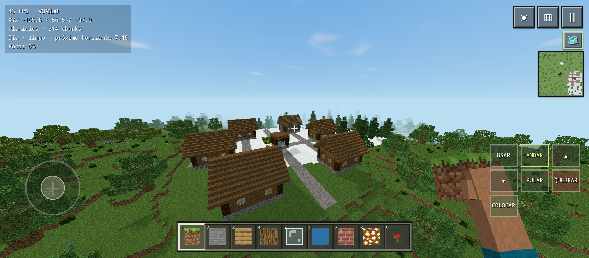
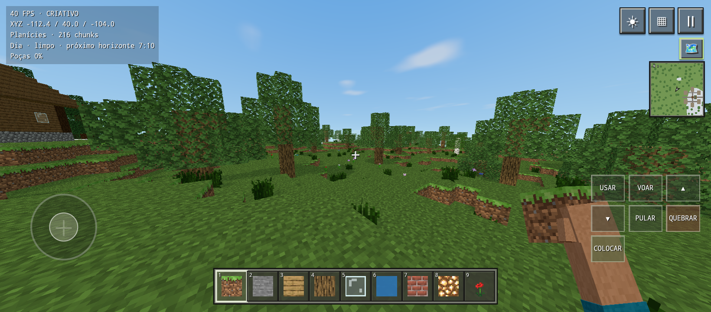
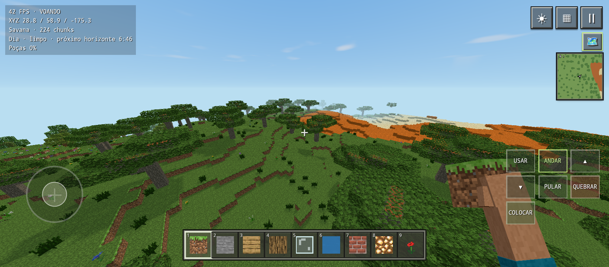
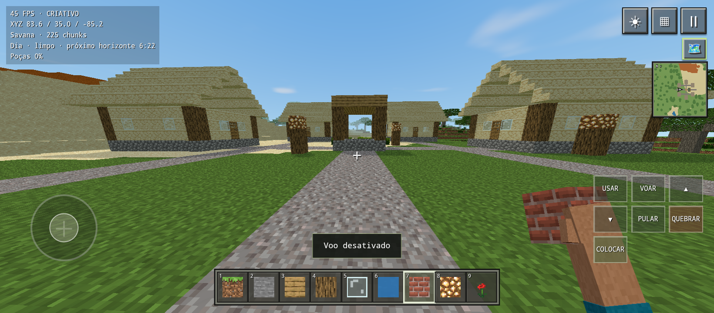
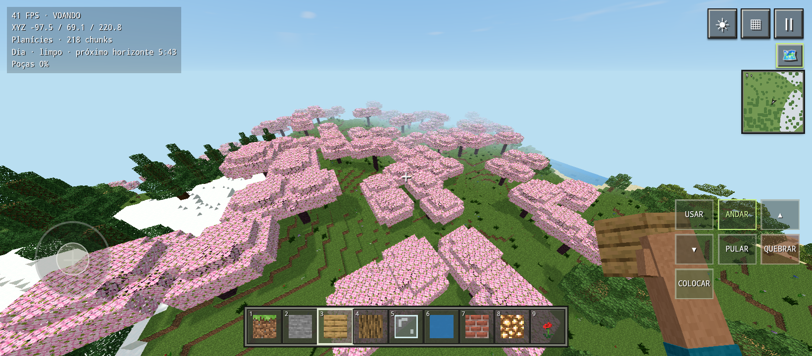
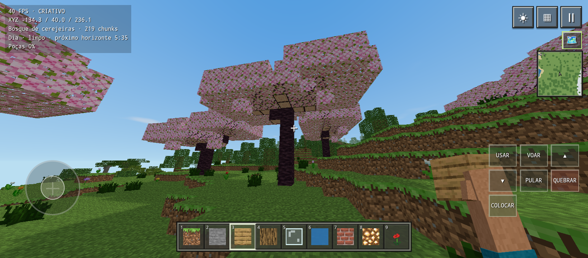

# Quadrum

**Construa, voe e explore um mundo voxel direto no navegador.**

## Novidades · 0.3.8

- Geração de terreno em **Web Worker**: os chunks não travam mais a thread principal e o FPS fica estável ao explorar.
- Mesher mais rápido (normais por face e corte da coluna vazia) e sem "paredes" falsas entre chunks.
- Braço e item na mão refeitos, com itens pequenos na escala certa.
- Inventário abre e busca mais rápido.

## Novidades · 0.3.7

Novo menu em **Ajustes → Gráficos** e **Pausa → Gráficos**:

- Sombras reais opcionais, **desligadas por padrão**, com liberação dos mapas GPU ao desligar.
- Pixel ratio absoluto de **0,5 a 2**, padrão **1**, sem multiplicar pelo DPR do aparelho.
- Filtros **Normal (sem filtro), Vívido e Clássico**. Não há filtro Água/Ocean.
- Preferências globais salvas no navegador e botão para restaurar os padrões.
- Saves antigos não religam sombras sozinhos; a iluminação mais clara continua sem sombras.

Para desempenho, use pixel ratio 0,5–1 e deixe sombras/filtros desligados. Pixel ratio
2 desenha quatro vezes mais pixels que 1; os filtros opcionais também podem ter custo.

## Novidades · 0.3.6

- Iluminação mais clara no amanhecer/entardecer e noite mais legível.
- Sol direcional mais forte e sombras locais opcionais (512px, até 5 atualizações/s).
  Desligue em **☀ → Sombras locais do sol** se pesar no aparelho.
- Nove silhuetas de árvores, incluindo cerejeiras bifurcadas de copa larga.
- Espaçamento variável entre troncos, em geral 5–8 blocos, sem distribuição em grade.
- **Crie um mundo novo** para as árvores do gerador v3. Saves v1/v2 mantêm as
  formas/distribuição anteriores; recebem a iluminação nova.
- Editor de HUD: **Ocultar** esconde os ajustes sem sair da edição; **☰ Ajustes HUD**
  reabre o painel sem perder o rascunho. Ocultar não salva automaticamente.

As árvores são aproximações próprias inspiradas nas espécies, não o algoritmo
exato do Minecraft. Sombras são locais, não ray tracing nem iluminação global.

## Correção · 0.3.5

- API central `api.ui.panel` para menus de mods: mantém câmera e joystick ativos no celular fora do painel.
- No desktop, coordena a liberação do mouse entre vários painéis e restaura controles com segurança.
- Mods devem usar a API; código antigo que desliga controles diretamente precisa ser adaptado.

## Novidades · 0.3.4

- Fragmentos com recortes da própria textura ao colocar e quebrar blocos.
- Minimapa com norte e direção do jogador; botão 🗺 liga/desliga. Usa apenas chunks carregados.
- Vilas procedurais com casas, caminhos de cascalho, poço e horta.
- Crie um mundo novo para testar as vilas; mundos antigos preservam a geração anterior.

## Jogar online

**[▶ Abrir Quadrum — quadrum-chi.vercel.app](https://quadrum-chi.vercel.app/)**

**[▶ GitHub Pages — zerolimites0001-web.github.io/quadrum](https://zerolimites0001-web.github.io/quadrum/)**

**[📦 Releases e ZIP do jogo](https://github.com/zerolimites0001-web/quadrum/releases)**

Cada endereço mantém seus próprios saves no navegador. Para levar um mundo da
Vercel ao GitHub Pages, exporte o backup em um e importe no outro.

O Pages é atualizado automaticamente a cada push na `main`, publicando somente os
arquivos públicos do jogo; testes não são enviados.

Jogue direto no navegador, sem instalar. Os mundos ficam salvos no navegador
desse endereço; use a exportação de mundos para fazer backups ou transferi-los.


[](LICENSE)

Quadrum é um jogo voxel em modo criativo, desenvolvido para **celular e desktop**.
Tem terreno procedural por chunks, construção livre, voo, mundos persistentes e
uma API de mods com acesso ao Three.js e aos sistemas do jogo.

**Sem build, sem dependências npm para jogar e sem downloads de bibliotecas em
runtime.** O Three.js e os recursos necessários estão incluídos no repositório.
O jogo-base não carrega mods sozinho. Céu e poças usam shaders integrados;
o shader de água de um pacote continua sendo opcional.

> Projeto em desenvolvimento. Não é uma implementação completa do Minecraft,
> nem um produto oficial da Mojang/Microsoft. Muitos blocos são decorativos;
> sobrevivência, mobs, máquinas, redstone funcional e multiplayer ainda não existem.

## Capturas de tela

Imagens do Quadrum no celular, enviadas pelo autor. Desempenho e aparência variam
conforme aparelho, distância de visão e configurações.

| Vila vista de cima | Floresta |
| --- | --- |
|  |  |

| Terreno e biomas | Vila no deserto |
| --- | --- |
|  |  |

| Bosque de cerejeiras | Cerejeira de perto |
| --- | --- |
|  |  |

## Navegação

- [Jogar online](https://quadrum-chi.vercel.app/)
- [Executar](#executar)
- [Recursos](#recursos)
- [Controles](#controles)
- [Mundos e backups](#mundos-e-backups)
- [Mods](#mods)
- [Estrutura](#estrutura)
- [Validação e contribuição](#validação-e-contribuição)
- [API de mods](MODDING.md)
- [Histórico de alterações](CHANGELOG.md)
- [Créditos e recursos de terceiros](THIRD_PARTY_NOTICES.md)

## Executar

Requisitos para jogar: **Python 3** para servir os arquivos e navegador com
**WebGL 2**. Mods importados usam IndexedDB e Service Worker em localhost/HTTPS.

```sh
git clone https://github.com/zerolimites0001-web/quadrum.git
cd quadrum
python3 server.py --port 8081
```

Abra **http://127.0.0.1:8081** no mesmo aparelho.

No Termux/Android, execute os mesmos comandos em uma pasta onde você tenha acesso.
Se o projeto já estiver em `/sdcard/Quadrum`, basta entrar nessa pasta e executar
o servidor. Não é preciso instalar Chromium, bundlers ou ferramentas pesadas.

Com Node disponível, `npm start` inicia o mesmo servidor. **Não é necessário
`npm install`.** Para apenas jogar, Node também não é necessário.

### Outros servidores e hospedagem

O jogo é estático e pode ser servido por outro servidor HTTP ou hospedagem HTTPS.
Mantenha os arquivos e subpastas juntos, incluindo `mod-worker.js` e `vendor/`.
Não abra `index.html` por `file://`: módulos e a importação de mods precisam de HTTP.
Um link público do repositório, por si só, não hospeda o jogo.

O servidor fornecido serve somente a pasta do projeto, por padrão em loopback.
**Não monta pastas externas nem procura mods no armazenamento interno.**

## Recursos

- **Modo criativo:** quebrar, colocar, selecionar blocos e voar.
- **264 blocos, plantas e peças de construção visíveis**, com inventário pesquisável.
- **Escadas e lajes em 17 materiais**, com orientação, variantes invertidas,
  colisão e seleção pela forma.
- **Portas funcionais de nove madeiras**, com duas metades vinculadas e abrir/fechar.
- **Dia de 10 minutos e noite de 8 minutos e 10 segundos**, com amanhecer,
  crepúsculo, lua oficial com fases e sol procedural com halo suave.
- **Chuva, neve e neblina**, incluindo variação automática por bioma.
- **Poças com reflexos planares**: esperam 5 minutos após a chuva e secam
  gradualmente nos 3 minutos seguintes, sem substituir blocos.
- **16 biomas**, incluindo florestas, taiga, selva, savana, deserto, manguezal,
  cerejeiras, bosque pálido, tundra, montanhas, praias e oceano.
- **Nove variantes de árvores**, com troncos e folhas da espécie correspondente.
- **Terreno Perlin contínuo em X/Z**, carregado e descartado por chunks;
  altura atual limitada a 96 blocos.
- **Joystick multitouch**, câmera por arraste e botões de ação para celular.
- **Mundos em IndexedDB:** nome, semente, posição, hotbar e alterações de blocos.
- **Exportação/importação de mundos** em JSON.
- Ajustes de distância de visão, sensibilidade, FOV, som e coordenadas/FPS.
- **Mods por importação manual:** ZIP, pasta ou JavaScript único.
- **API v1:** blocos, itens, sistemas, eventos, UI, texturas, sons, animações,
  efeitos, shaders, render targets e acesso à câmera/canvas/cena/Three.js.
- Desligamento rastreado por `kill.js`, com preservação de blocos nos saves.

## Céu, clima e construção

No inventário, procure **Escadas**, **Lajes** e **Portas**. Escadas acompanham a
direção do jogador; lajes podem ocupar a metade superior/inferior e duas iguais
completam o bloco correspondente. As portas exigem apoio e dois blocos livres;
quebrar uma metade ou o apoio remove o par. Não fecham sobre o jogador.

O botão **☀** abre o painel de clima e ciclo. Nele, você pode escolher horários,
forçar chuva/neve/neblina, ligar o modo automático e reduzir efeitos para celular.
O ciclo e os temporizadores ficam salvos com o mundo e param durante a pausa.

A chuva usa a cor de um recorte **1×1 de water_still.png**, sem baixar uma textura
nova de chuva. Neve é visual e não substitui suas construções. Poças surgem em
superfícies expostas elegíveis e não ocupam blocos. Seu reflexo é um passe planar
128px da altura predominante, limitado a cerca de 4 atualizações/s, não ray tracing.
Se ficar pesado, desligue reflexos no painel antes de aumentar a distância de visão.

O sol tem um halo suave aditivo; olhar para ele não causa dano, cegueira, alteração
de exposição, lens flare ou God Rays. A lua usa a textura oficial incluída.
Desative mods que substituem céu/luzes/reflexos ao conferir os novos efeitos,
pois a combinação de vários sistemas gráficos não é garantida.

## Mão em primeira pessoa

Mão voxel com animações próprias para **quebrar**, **colocar** e **usar**.
O bloco/item segurado acompanha a hotbar, incluindo formas parciais e itens de mods.
Há um pequeno balanço ao andar e movimento de troca de slot, sem alterar a câmera.

Em **Ajustes**, é possível desligar separadamente:

- **Mão em primeira pessoa**.
- **Mostrar bloco/item na mão**.
- **Balanço da mão ao andar**.

As preferências ficam salvas neste navegador. A mão usa malhas simples e texturas
procedurais originais, sem baixar uma skin externa. Seu passe de desenho é separado
do mundo: não entra em reflexos, raycasts ou colisão, e não cobre os controles DOM.
Pausa, inventário e editor de HUD não exibem a mão. Não há corpo em terceira pessoa
ou mineração progressiva: as animações são uma apresentação visual das ações.

## Editor de HUD

Entre no mundo e abra **Pausa → Editar HUD** ou **Ajustes → Editar HUD**.

- Mova 15 elementos arrastando suas caixas: joystick, ações, hotbar, botões e textos.
- Redimensione pelo canto **↘** ou pelo controle **Tamanho**.
- Faça ajustes finos pelos controles X/Y e setas.
- **↕** move o painel entre topo/baixo; **▤** recolhe as opções.
- **Salvar HUD** grava o layout; **Cancelar**/Esc descarta o rascunho.
- **Exportar HUD · JSON** baixa `quadrum-hud.json` com o rascunho atual, nos dois
  perfis, sem arredondar posições ou escalas.
- **Importar HUD · JSON** aplica uma prévia; só substitui o save ao tocar em
  **Salvar HUD**. Arquivos inválidos não apagam a configuração atual.
- Restaure o padrão de um item ou de toda a orientação atual, sem perder o outro perfil.

Retrato e paisagem têm layouts independentes. Os controles são limitados à área
visível; a mira pode mudar de tamanho, mas permanece no centro para manter a
pontaria correta. O joystick mantém a região de toque proporcional à escala.

O layout fica no localStorage, chave `quadrum-hud-layout-v1`, por origem/perfil do
navegador. Não modifica o mundo nem os arquivos de mods. Limpar os dados do site
apaga esse layout; um erro de gravação é mostrado sem descartar o rascunho.
Interfaces próprias de mods não são editadas nesta versão.

O arquivo usa o mesmo esquema do armazenamento, sem wrapper ou timestamp:

```json
{
  "version": 1,
  "profiles": {
    "portrait": {
      "action-place": {"x": 0.8123456789012345, "y": 0.7123456789012345, "scale": 1.23456789012345}
    },
    "landscape": {}
  }
}
```

Perfis vazios usam o padrão. A ida/volta preserva os números; o ajuste visual aos
limites de outra tela não regrava esses valores. A importação é manual, limitada
a 64 KB, sem execução de código ou rede. Versões, campos, posições ou escalas
inválidas são recusados em vez de corrigidos silenciosamente.


## Controles

### Celular

| Ação | Controle |
| --- | --- |
| Mover | Joystick esquerdo |
| Olhar | Arrastar no mundo |
| Quebrar / colocar | Botões próprios à direita |
| Pular | PULAR |
| Abrir/fechar porta | USAR ou COLOCAR mirando a porta |
| Alternar voo | VOAR / ANDAR ou duplo toque em pular |
| Subir / descer voando | ▲ / ▼ |
| Inventário | ▦ |
| Pausar | Ⅱ |
| Escolher bloco | Tocar na hotbar ou selecionar no inventário |

É possível mover, olhar e usar os botões com dedos diferentes simultaneamente.

### Desktop

| Ação | Controle |
| --- | --- |
| Mover | WASD |
| Olhar | Mouse; clique no canvas para capturar |
| Quebrar / colocar | Clique esquerdo / direito |
| Copiar bloco apontado | Botão do meio |
| Selecionar slot | 1–9 ou roda do mouse |
| Inventário | E |
| Pular / subir voando | Espaço |
| Alternar voo | F ou duplo espaço |
| Descer voando | Shift |
| Acelerar | Ctrl |
| Pausar | Esc |
| Usar/abrir porta | R ou clique direito |

## Mundos e backups

Crie um mundo com nome e semente opcional e toque em **JOGAR**. Use **Salvar e
sair** para voltar ao menu. O jogo também salva automaticamente durante a sessão.

| Dados | Armazenamento |
| --- | --- |
| Mundos e edições | IndexedDB `quadrum-worlds` |
| Arquivos e estado de ativação dos mods | IndexedDB `quadrum-imported-mods` |
| Preferências da interface e cache de compatibilidade | localStorage |

**Os saves ficam no navegador, não no GitHub nem em uma conta online.** Use sempre
o mesmo endereço, porta e perfil do navegador. Trocar de origem, limpar dados do
site ou usar navegação privada pode tornar os dados indisponíveis.

Exporte backups no menu de mundos, principalmente antes de limpar dados do
navegador ou testar mods. Dados pessoais e saves não fazem parte deste repositório.

## Mods

### Instalar manualmente

1. Abra **Mods** no menu inicial ou na pausa.
2. Escolha **Importar ZIP**, **Importar pasta** ou **JS / arquivos**.
3. Selecione explicitamente o pacote no seletor do navegador.
4. Confira a origem e confirme **Ativar**.
5. Para desligar, volte à lista e toque em **Desativar**.

**Pacotes novos e versões reimportadas começam desligados.** Depois que você
ativa ou desativa um pacote, essa preferência é salva automaticamente junto aos
metadados do mod no IndexedDB e restaurada ao reabrir a mesma origem. A lista
mostra se a ativação está salva. Uma falha temporária de carregamento aparece
como erro, mas não apaga a escolha anterior de ativá-lo.

**Não existe varredura automática de pastas, importação por caminho/URL ou acesso
genérico ao armazenamento do aparelho.** O loader recebe apenas os arquivos
escolhidos e mantém uma cópia no IndexedDB. O Service Worker fornece esses Blobs
em uma rota virtual para preservar imports relativos, CSS e recursos em subpastas.
Pacotes já importados e habilitados podem ser reativados dessa cópia ao abrir o jogo.

No celular, ZIP costuma ser a opção mais prática. Se a seleção de pasta ou a
descompactação nativa não estiver disponível no seu navegador, veja as alternativas
no [guia de mods](MODDING.md).

### Exemplos incluídos

| Exemplo | O que demonstra |
| --- | --- |
| [realistic-water.zip](examples/mods/realistic-water.zip) | Pacote pronto para importar: ondas, Fresnel e reflexo planar da cena |
| [Fontes da água](examples/mods/realistic-water/) | Manifesto, JS, CSS, HTML e shaders em subpastas |
| [exemplo-bloco.js](examples/mods/exemplo-bloco.js) | Um único JS que registra bloco, item, partículas e som |

Baixe o arquivo desejado e importe pelo menu do jogo. Os exemplos **não são
ativados automaticamente**, mesmo estando no repositório.

A água realista usa reflexo planar de 256px, limitado a aproximadamente 8 FPS,
com opções de 128/256/512px e reflexo desligável. Reflete a altura dominante da
água; não é ray tracing nem simulação física de fluido.

A água original fica em uma camada própria: **desativar o shader restaura sua
visibilidade imediatamente**, sem recriar o mundo ou apagar blocos.

### Criar um pacote

```text
meu-mod/
├── pack.json
├── src/main.js
├── ui/menu.css
├── ui/menu.html
└── textures/bloco.png
```

```json
{
  "uuid": "4d370100-99de-4505-862b-356ce196ebee",
  "name": "Meu mod",
  "description": "Meu primeiro pacote para Quadrum",
  "version": "1.0.0",
  "apiVersion": 1,
  "files": {"js": ["src/main.js"]}
}
```

```js
export default async function activate(api) {
  await api.blocks.register('cristal', {
    name: 'Cristal',
    color: '#6de5ed',
    category: 'Meu mod'
  });
  api.events.on('worldEnter', () => api.toast('Meu mod está ativo!'));
}
```

**[Leia o guia completo da API → MODDING.md](MODDING.md)**

### Segurança e desligamento

Mods são código confiável, **não uma sandbox**: podem acessar a página e os dados
dessa origem. Só ative código que você conheça e faça backup dos mundos.

O engine cria automaticamente um escopo `kill.js` para rastrear recursos e limpar
UI, eventos, timers, objetos, materiais, shaders e overrides ao desligar o pacote.
Blocos salvos de mods ausentes são preservados como placeholders, não apagados.

Nenhum mecanismo na mesma thread consegue interromper um `while(true)` ou desfazer
qualquer alteração arbitrária em JavaScript. Recursos fora do rastreamento precisam
de limpeza explícita. As garantias e limitações estão detalhadas no guia.

## Estrutura

```text
index.html             Interface e ponto de entrada
src/                   Engine, terreno, física, controles, UI, saves e API de mods
mod-worker.js          Ponte HTTP virtual dos Blobs importados
server.py              Servidor estático local, sem montagem de diretórios externos
vendor/                Three.js local e sua licença
assets/textures/       Texturas e manifesto
examples/mods/         Exemplos de mods, fontes e ZIP pronto
docs/screenshots/      Capturas de tela do Quadrum
```

O código do céu e das poças está em `src/sky.js` e `src/puddles.js`.
Shaders do exemplo de água pertencem ao próprio pacote.

## Validação e contribuição

**Os arquivos de testes são mantidos somente no ambiente local de desenvolvimento.**
Não fazem parte desta distribuição e estão ignorados no Git. Não é necessário
instalar ferramentas de teste para jogar. A versão 0.3.0 foi conferida localmente
com 77 casos de lógica e validada visualmente pelo usuário no aparelho antes da
publicação; isso não garante o mesmo desempenho em todas as GPUs/navegadores.

A CI antiga de testes foi removida para não depender de arquivos que não são mais
publicados. Para contribuir, veja [CONTRIBUTING.md](CONTRIBUTING.md).

## Licença

O código original, a documentação e os exemplos de mods do Quadrum são
licenciados sob a **[MIT License](LICENSE)**. Você pode usar, modificar e
redistribuir esse software, inclusive comercialmente, preservando os avisos
exigidos pela licença. O software é fornecido sem garantias.

**Recursos de terceiros não são relicenciados por essa autorização.** Texturas
Minecraft/Bedrock Samples e bibliotecas mantêm seus
próprios direitos e termos, descritos abaixo e nos avisos de terceiros.

## Créditos e direitos

- Three.js está incluído com sua licença MIT em
  [`vendor/THREE-LICENSE.txt`](vendor/THREE-LICENSE.txt).
- Texturas do Minecraft/Bedrock Samples pertencem aos respectivos titulares;
  não são arte original do Quadrum e não são automaticamente cobertas pela licença
  do Three.js.

Consulte [THIRD_PARTY_NOTICES.md](THIRD_PARTY_NOTICES.md) e os termos dos recursos
antes de redistribuir. A MIT do código do Quadrum não altera os direitos de
terceiros nem autoriza automaticamente o uso de todos os recursos gráficos.
